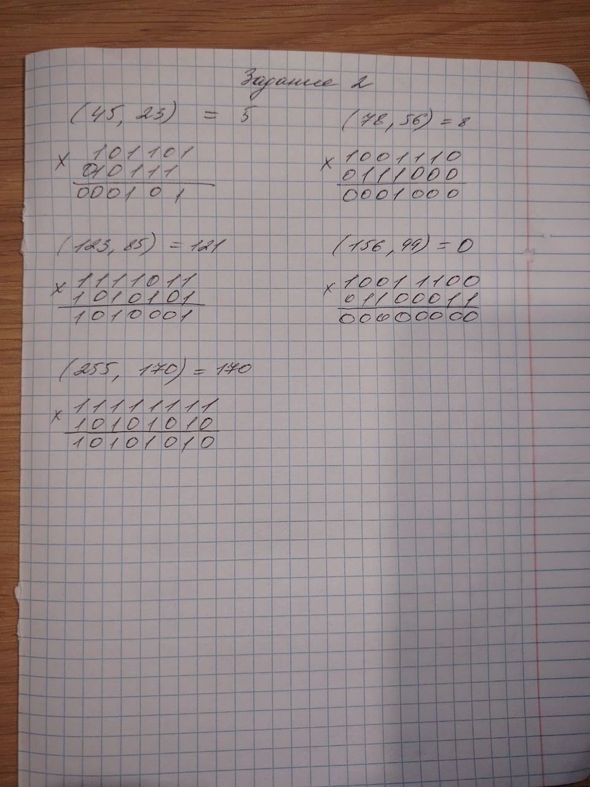

# Мое домашнее задание № 4

## Задание № 4.1

## Задание № 4.2

## Задание № 4.3. Часть А
1) IP: 192.168.10.77 Маска: 255.255.255.192
   IP:    11000000.10101000.00001010.01001101          
   Маска: 11111111.11111111.11111111.11000000

Адрес сети:        11000000.10101000.00001010.01000000
                   192.168.10.64/26
Broadcast:         192.168.10.127
Первый хост:       192.168.10.65
Последний хост:    192.168.10.126
Количество хостов: 62

2) IP: 10.10.10.200 Маска: 255.255.255.224
   IP:    00001010.00001010.00001010.11001000          
   Маска: 11111111.11111111.11111111.11100000
   
Адрес сети:        00001010.00001010.00001010.11000000
                   10.10.10.192/27
Broadcast:         10.10.10.223
Первый хост:       10.10.10.193
Последний хост:    10.10.10.222
Количество хостов: 30

3) IP: 192.168.1.250 Маска: 255.255.255.240
   IP:    11000000.10101000.00000001.11111010          
   Маска: 11111111.11111111.11111111.11110000

Адрес сети:        11000000.10101000.00001010.11110000
                   192.168.1.240/28
Broadcast:         192.168.10.255
Первый хост:       192.168.10.241
Последний хост:    192.168.10.254
Количество хостов: 14

